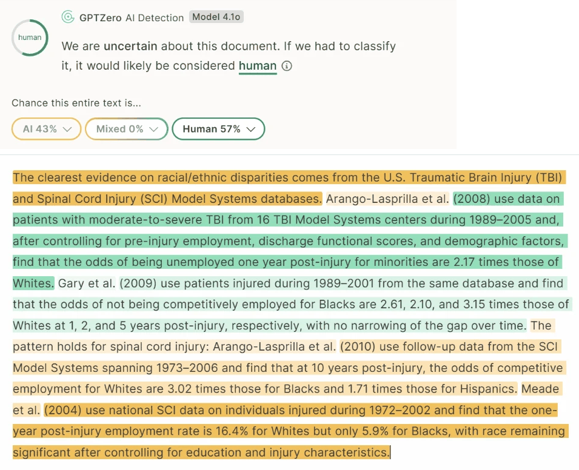
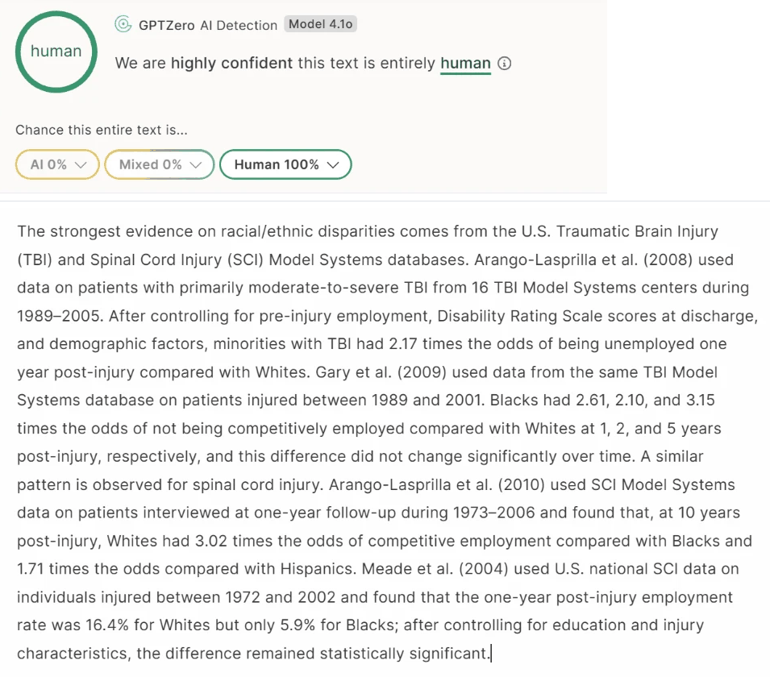

# corpus-bootstrap

[English](README.md) | 简体中文

**让你的论文读起来像本领域的文献。**

一个 [Claude Code](https://claude.com/claude-code) skill。它从你为某个研究领域收集的论文里，学会这个领域的写法，再据此生成三个写作助手：

- **`<field>-lit`**：审查你写的一段文字，报告它读起来像不像本领域的文献。它会对照你的语料检查术语，套用文风规则，并检查句与句之间的衔接。改完的文字还给你，论点、引用和数字一律不动。
- **`<field>-draft`**：一次起草一段。每一段都沿用语料里至少两篇论文用过的结构（叫作一个 “Version”）。每个论断在写成句子之前，必须先在台账里登记一行，贴上出处原文。它还能给写好的章节做反向提纲（`--outline`），也能把引言或摘要里的论断追溯到支撑它的表格（`--trace`）。
- **`<field>-polish`**：在你自己的 `main.tex` 上一节一节改稿。它对照语料扫描全文，到被引论文的 PDF 里核对少见的词，把每一句改过的论断对回原文，最后编译稿件并把这一节渲染成可读文本。章节和每个引用对应的 PDF 都由它自己找，不用填配置文件。

**一键接入**：给它一份稿件和你的文献库（PDF 文件夹、Zotero 或 JabRef 导出的 `.bib`，或者 PDF 加阅读笔记），它会把每个引用对到 PDF，并一口气跑完第 0、1 关。

所有数字都不从别的领域照搬：术语频次、段落长度、衔接常模、章节分类、引述他人结论时用的动词阶梯，全部在你自己的语料上重新测量。

> **注意：搭建参照库非常耗 token。** 60 篇左右的语料，预计要用掉几亿 token，子代理要跑大半天。开始之前请先看 [Token 用量](#token-用量)。

## 为什么做这个项目

我们大多数人学一个领域的写法，靠的是慢功夫：读几百篇论文，慢慢知道大家用哪些术语、一段话通常怎么开头、转述别人的结论该用哪个动词。语法检查工具和通用的 AI 助手给不了这些。它们写出的句子通顺，但泛泛而谈；会用本领域没人用的说法，读起来有 AI 腔；还可能把一篇论文转述的别人的结论，说成这篇论文自己的发现。

这个项目想帮大家把论文写得更好，办法是把你所在领域的论文当作标准。论文由你收集，skill 测量这些论文是怎么写的，再拿它们来检查你的文字。每条建议都附上证据：你的语料里有几篇论文这样写，原句是哪一句。你能看到每处修改的理由，改不改由你决定。

## 适合谁

- **研究生和青年学者**：直接从本领域的论文学写法，看到的是计数和例句。
- **英文非母语的作者**：语法可能没问题，但用词和句式还是会露出痕迹。每条建议都列出用这种说法的论文，你能看到改动背后的地道表达。
- **跨领域的研究者**：用新领域的论文建好参照，这个领域的术语和段落惯例一开始就摆在你面前。
- **用 AI 辅助写作的人**：AI 写的文字往往通顺但空泛，还可能出现原文里没有的术语或归因。`-lit` 会标出本领域不用的说法；`-draft` 写出的每个论断都在台账里有出处原句，找不到出处的会标出来提醒你核对。

## 它能帮你做什么

**`<field>-lit`：每条意见都附证据的审稿人**

- 逐个对照语料检查术语，报告有几篇论文用过，并引用其中一句原文。
- 把含糊的名词换成本领域用的准确术语。
- 只有当你的语料也很少这样写时，才把一个说法判为 “AI 腔”；在你的语料里有 3 篇以上论文用过的说法，就算本领域的正常写法。
- 给每一句和上一句之间的衔接打分。
- 每处修改都写明理由，拿不准的问题列在 “留给作者” 里。
- 不改你的论点、引用和数字。

**`<field>-draft`：先建出处台账再动笔的起草人**

- 先选一个段落结构，要求你的语料里至少有两篇论文用它做同样的事。
- 动笔前先建论断台账：每个论断一行，写明引述动词，并贴上论文原句；找不到出处的标 `!!`。
- 引述他人结论的动词不能比原文支持的更强，用的是在你的语料上测出的 “动词阶梯”，例如报告结果用 “find that”，原文支持较弱时退到 “note that”。
- 能给写好的章节做反向提纲，也能把引言或摘要里的论断追溯到支撑它的表格。

**`<field>-polish`：逐节改稿，改完对回原文**

- 对照语料扫描全文：哪些词和多词说法没有一篇论文用过，哪些句子比语料句长的第 90 百分位还长。
- 到被引论文自己的 PDF 里查少见的词和每个领域术语。论文自己用的术语保留；你自己的说法换成语料里用的说法。
- 逐句读意思（范围不清、比较缺一方、动词比原文强），并把每一句改过的论断对回原文。
- 确认数字、引用 key 和出处注释都没有变，编译你的稿件，再把这一节渲染成文本，引用按 PDF 里显示的样子写出。
- 先存快照，只用“恰好出现一次”的精确替换改你的文件，并保留备份。

## 真实例子：一份文献综述

下面的片段来自一份关于工伤保险与医疗账单的文献综述草稿，对照的是这个领域 66 篇论文组成的语料（其中 51 篇用于文风判断）。片段只摘几行，语料里的论文编号换成了作者和年份。

计数的读法：`w:62` 表示总共出现 62 次；`range:10/66` 表示 66 篇论文里有 10 篇用过。

### 例 1：对照语料检查术语（`-lit`）

草稿里的三个说法：

> …medical costs paid through workers' compensation are higher than those paid through **general health insurance**…
>
> …fractures, lacerations, and other **clear-cut traumas** showed no such effect.
>
> …after the 2006 increase in the **weekly benefit ceiling**, affected workers' benefit duration increased by 11.1%…

`-lit` 改了什么、为什么改（摘录）：

```
CHANGED (3)

  1. "general health insurance" → "health insurance"
     R7/§3 — vague modifier; "health insurance" is the corpus standard (range:29/66);
     "general health insurance" appears in only 1 paper

  2. "clear-cut traumas" → "traumatic injuries"
     §3 — "clear-cut traumas" w:0 range:0/66; "traumatic injuries" w:62 range:10/66;
     Fomenko & Gruber (the paper being described) uses "traumatic injuries" 22 times

  3. "weekly benefit ceiling" → "maximum weekly benefit"
     §3 — "weekly benefit ceiling" w:0 range:0/66; "maximum weekly benefit" w:18 range:2/66;
     Cabral & Dillender (the paper being described) uses "maximum weekly benefit" 9 times
```

### 例 2：先建台账，再写句子（`-draft`）

写介绍 Graves et al. (2012) 的那一段时，`-draft` 选了 Version 3（逐项介绍研究，单篇），动笔前先填好台账。其中三行：

| cite-key | verb | claim | source | flag |
|---|---|---|---|---|
| Graves2012 | find that | Followed 1,830 workers identified from July 2002 to April 2004 | "From July 2002 to April 2004, 4354 workers were identified" (p.5); "the final study sample consisted of 1830 workers." (p.5) | |
| Graves2012 | find that | Male workers were 43% more likely to receive an early MRI within 42 days of injury than female workers | "Multivariable regression showed that male workers were 43% more likely to receive an early MRI than female workers (IRR: 1.43, 95% CI: 1.12--1.82)" (p.6) | |
| Graves2012 | find that | In Model 2, male IRR dropped to 1.24 (95% CI 0.98--1.58), no longer significant | Table 2 in the published journal version (not available in the PDF used for the note) | !! |

它起草的其中一句：

```latex
Male workers were 43\% more likely than female workers to receive an MRI within 42 days of injury (IRR 1.43, 95\% CI 1.12--1.82); after excluding self-report variables that could have been affected by interview timing, the authors stated that the overall pattern of associations was similar to the main model, but the male-to-female ratio dropped to 1.24 (95\% CI 0.98--1.58) and was no longer statistically significant.
```

`-draft` 没找到 1.24 这个数字的出处原句，于是把这一行标为 `!!` 等人核对，而不是当作已经确认。作者去查了，这个数字在论文第 16 页的表 2 里。

### 例 3：两个 skill 一起查措辞

有一段用 **“Regarding costs,”** 开头。`-lit` 判它合格，因为 51 篇论文里有 25 篇用过 “Regarding”。但 `-draft` 记录了语料里每一段是怎么开头的，结果不一样：语料的 2,702 个段落开头里，只有 2 个用 “Regarding”；那 25 篇论文都是在句中用它。于是这一段改成了用主语开头。

同一份综述里另外几处改写，每处都有语料计数作依据：

| 草稿的写法 | 语料里 | 改后的写法 |
|---|---|---|
| a longer time to return to work | 0/66 | delayed return to work（4/51） |
| mostly indicate | 0/51 | mostly suggest（"suggest"：33/51） |
| Industry composition can also alter aggregate results. | 0/51 | Aggregate results also depend on industry composition.（"depend on"：8/51） |
| Studies controlling for … find similar results. | 0/51 | Results from studies that control for injury type in regression models are consistent with these findings.（"results from"：20/51；"consistent with"：31/51） |

### 例 4：同一段，直接生成与用 `-polish` 改写

这是同一份综述 2.2 节（复工）的第 2 段。第一版是 Claude 不用这个工作流直接写出的初稿，第二版是 `<field>-polish` 走完 a–j 步之后的结果。引用按 PDF 里显示的样子写出。

**直接生成（未用工作流）**

> The clearest evidence on racial/ethnic disparities comes from the U.S. Traumatic Brain Injury (TBI) and Spinal Cord Injury (SCI) Model Systems databases. Arango-Lasprilla et al. (2008) use data on patients with moderate-to-severe TBI from 16 TBI Model Systems centers during 1989–2005 and, after controlling for pre-injury employment, discharge functional scores, and demographic factors, find that the odds of being unemployed one year post-injury for minorities are 2.17 times those of Whites. Gary et al. (2009) use patients injured during 1989–2001 from the same database and find that the odds of not being competitively employed for Blacks are 2.61, 2.10, and 3.15 times those of Whites at 1, 2, and 5 years post-injury, respectively, with no narrowing of the gap over time. The pattern holds for spinal cord injury: Arango-Lasprilla et al. (2010) use follow-up data from the SCI Model Systems spanning 1973–2006 and find that at 10 years post-injury, the odds of competitive employment for Whites are 3.02 times those for Blacks and 1.71 times those for Hispanics. Meade et al. (2004) use national SCI data on individuals injured during 1972–2002 and find that the one-year post-injury employment rate is 16.4% for Whites but only 5.9% for Blacks, with race remaining significant after controlling for education and injury characteristics.

**用 `-polish` 改写后**

> The strongest evidence on racial/ethnic disparities comes from the U.S. Traumatic Brain Injury (TBI) and Spinal Cord Injury (SCI) Model Systems databases. Arango-Lasprilla et al. (2008) used data on patients with primarily moderate-to-severe TBI from 16 TBI Model Systems centers during 1989–2005. After controlling for pre-injury employment, Disability Rating Scale scores at discharge, and demographic factors, minorities with TBI had 2.17 times the odds of being unemployed one year post-injury compared with Whites. Gary et al. (2009) used data from the same TBI Model Systems database on patients injured between 1989 and 2001. Blacks had 2.61, 2.10, and 3.15 times the odds of not being competitively employed compared with Whites at 1, 2, and 5 years post-injury, respectively, and this difference did not change significantly over time. A similar pattern is observed for spinal cord injury. Arango-Lasprilla et al. (2010) used SCI Model Systems data on patients interviewed at one-year follow-up during 1973–2006 and found that, at 10 years post-injury, Whites had 3.02 times the odds of competitive employment compared with Blacks and 1.71 times the odds compared with Hispanics. Meade et al. (2004) used U.S. national SCI data on individuals injured between 1972 and 2002 and found that the one-year post-injury employment rate was 16.4% for Whites but only 5.9% for Blacks; after controlling for education and injury characteristics, the difference remained statistically significant.

我们把两版分别贴进 GPTZero（Model 4.1o，Advanced Scan）：

| | 直接生成 | 用 `-polish` 改写后 |
|---|---|---|
| 长度 | 209 词 | 225 词 |
| 判定 | "We are uncertain about this document. If we had to classify it, it would likely be considered human"（不确定，若要归类大概算人写的） | "We are highly confident this text is entirely human"（高度确信全文是人写的） |
| AI / Mixed / Human | 43% / 0% / 57% | 0% / 0% / 100% |

第一版里，GPTZero 把开头一句（"The clearest evidence…"）和 Meade et al. (2004) 那一句标为最像 AI 的句子。





有 4 处改动来自被引论文，每处都对照 PDF 核对过：

| 直接生成 | 改写后 | 论文原文 |
|---|---|---|
| patients with moderate-to-severe TBI | patients with **primarily** moderate-to-severe TBI | "Subjects with primarily moderate to severe TBI"（Arango-Lasprilla et al. 2008，第 1 页） |
| discharge functional scores | **Disability Rating Scale** scores at discharge | "after adjusting for preinjury employment status, sex, Disability Rating Scale at discharge, …"（同一篇，第 1 页） |
| with no narrowing of the gap over time | this difference **did not change significantly** over time | "for blacks as compared with whites did not change significantly over time"（Gary et al. 2009，第 6 页） |
| follow-up data from the SCI Model Systems spanning 1973–2006 | data on patients **interviewed at one-year follow-up** during 1973–2006 | "who were interviewed during their scheduled 1-year post-injury, follow-up evaluation between 1973 and 2006"（Arango-Lasprilla et al. 2010，第 3 页） |

第三行这处改动要紧：比值本身从第 1 年的 2.61 降到了第 2 年的 2.10，说“差距没有缩小”并不成立；论文检验的是这个变化是否显著。其余改动属于文风：Arango-Lasprilla et al. (2008) 和 Gary et al. (2009) 两句各拆成一句讲设计、一句讲结果；动词改成过去时；“clearest”（51 篇文风语料里 0 篇用）换成 “strongest”（7 篇用）；“minorities with TBI” 接上了前一句的话题。这一节的 43 个数字和 9 个引用 key 都没有变。

这只是一段文字、一个检测器、扫一次的结果。检测分数随工具和版本变化，也不能说明文字是谁写的。工作流的目标是让一节文字读起来像本领域的论文、说的和原文一致；它没有任何针对检测器的步骤。

## 它会漏掉什么

这份综述也暴露了下面这些问题：

- **`-lit` 查的是措辞，不是事实。** 上面那一段的另一份草稿没有建台账，把 1.24 写成了 “odds ratio”，而 Graves et al. 报告的是 incidence rate ratio。`-lit` 对那一节一处都没改，因为措辞本身没问题。这个错误是逐句对照原文核对时才查出来的。
- **第一轮审查可能偏松。** 第一轮里 13 节审查全部 “通过”，但全文仍有 12 处 “the authors argue”（51 篇论文里没有一篇这样写），句长中位数是 44 词，语料是 25 词。之后按更严的规则逐节重审：先扫描全文，拆开长句，再把每个术语和框架句重新查一遍。
- **“论文专用词，保留” 需要人来复核。** `-lit` 认为 “acute low back sprains” 是 Graves et al. 自己的说法，所以保留了；其实原文写的是 “back sprain/strain”，定稿改成了跟原文一致。
- **有些改动会删掉意思。** `-lit` 曾把 “fairly consistent” 改成 “consistent”，还删掉了 “the resulting”。这两个词都带着意思，两处改动后来都撤回了。
- **语料里有的说法，放进你的句子也可能是错的。** 在例 4 那一节里，`-polish` 保留了 “After controlling for injury severity and other factors, women were more likely than men…”，因为语料里有 9 篇论文用 “after controlling for”。可这一句是悬垂修饰：做控制的并不是 women。语料核对管的是措辞，管不了语法。

数字和结论请对照原文核对；每个论断从哪里来，可以看 `-draft` 的台账；每处修改都要读过再接受。

## 设计原则

- 工具不改你的论点、引用和数字。
- 语料是唯一依据：每个判断都引用你自己语料里的计数和原句。
- 起草出的每个论断都有出处原句，或者有一个看得见的标记。
- 论文由你提供。这个 skill 不抓取、不爬网页，也不调用任何 API。
- 每过一关都会停下来（一键接入时第 0、1 关连着跑完），章节分类要等你批准。

## 工作方式

搭建分五关进行。每一关结束都有验收：一个 `check_drift` 脚本，加上一项需要你亲自看的检查。每过一关，skill 都会停下来等你确认（一键接入例外，见下文）。

| 关 | 产出 | 成本 | 验收 |
|---|---|---|---|
| **0 语料** | 把 PDF 转成文本；来源清单（源文件哈希、转换器及版本，并标出扫描件、短文档和编码损坏）；四种口径的语料清单 | 脚本，几分钟 | 你审阅清单；lit 的 `check_drift` 第 0 关通过 |
| **1 文风层** | 文风测量、衔接常模、过渡语库。**从这一关起 `<field>-lit` 可以用了** | 只跑脚本 | lit 的 `check_drift` 第 1 关通过；你读一次实际审查结果 |
| **2 章节图** | 每篇论文的标题；从你的论文里归纳出的章节分类（**需要你批准**）；标注好的章节图；按章切片 | 1 轮归纳 + 约 4–8 轮标注 | 与人工核对的样本一致率 ≥ 90%；你读分类表和 3 个切片 |
| **3 阅读记录与 Version** | 逐段阅读记录；每章至少有 2 篇论文佐证的段落结构。**从这一关起 `<field>-draft` 可以用了** | 约 27 ×（论文数 / 60）轮阅读，加每章 1 轮，逐章进行 | draft 的 `check_drift` 第 3 关通过；你读一整章；起草出第一段 |
| **4 例句库** | 按 8 种修辞动作标注的例句库、动词阶梯、结构准则 | 每 10 篇约 1 轮 | 两个 `check_drift` 全部通过 |

这几轮阅读由 Claude Code 的子代理执行，提示词在 `templates/prompts/` 里。章节分类从你的论文里归纳，不预设。分类一旦错了，后面全部白做，所以第 2 关会停下来等你批准。

### 一键接入

从一份稿件开始时，`/corpus-bootstrap polish` 会依次运行下面的脚本。每个默认决定都会列成表打印出来，你可以改了再重跑。

| 步 | 脚本 | 做什么 |
|---|---|---|
| 1 | `onboard.py` | 读稿件（章节、引用 key、`.bib`、引用简称），把每个引用 key 对到 PDF：依次看 `.bib` 的 `file` 字段、阅读笔记里的 PDF 字段、以 key 命名的 PDF，再按 DOI、标题、第一作者加年份找。列出找不到 PDF 的引用、有多个候选的引用、重复的版本和不是英文的 PDF。生成这个领域的 skill（第一次会问你领域名和主题词）或沿用已有领域，并导入对上的 PDF |
| 2 | `tier0_accept.py` | 按默认决定完成第 0 关：扫描件和转换失败的排除，报告和书只用于查术语，篇幅很短的研究条目排除 |
| 3 | `calibrate_paragraphs.py` | 在 80 到 400 个字符之间扫描，选出这份语料的段落长度阈值 |
| 4 | `tier1_fill.py` | 建好文风层，并填上第 1 关要求的所有数字和判定，`check_drift` 不用手改就能通过 |
| 5 | （Claude） | 用 `<field>-lit` 审你稿件里的一段，把结果给你看 |
| 6 | `onboard.py --finish` | 列出 `<field>-polish` 哪些步骤已经能用，估算第 2–4 关的 token 和时间，再问你要不要继续搭 |

### `<field>-polish`：逐节改稿

| 步 | 做什么 | 需要 |
|---|---|---|
| a | 给这一节存快照 | 稿件 |
| b | 对照语料扫描全文，这一节查出的问题就是待办清单 | 第 0 关 |
| c | 拆长句；把框架句换成至少 3 篇论文用过的说法 | 第 0 关 |
| d | 用 `<field>-lit` 审稿，并给句间衔接打分 | 第 1 关 |
| d2 | 对照语料里各段的开头方式检查段首句 | 第 3 关 |
| e | 到被引论文的 PDF 里查少见的词和领域术语 | PDF |
| f | 逐句读意思（范围、比较、动词强弱） | |
| g | 确认数字、引用 key 和出处注释没变；检查段长和句长 | 第 0 关 |
| h2 | 把每一句改过的论断对回原文 | PDF |
| i | 编译稿件，要求 0 个警告；重新清点引用 | TeX |
| j | 把这一节渲染成可读文本给你看 | 编译出的 `.bbl` |

## Token 用量

第 0、1 关只跑脚本，几乎不用 token。第 2 到 4 关要由 Claude 子代理逐篇阅读，非常耗 token。

下面的数字来自一次真实搭建的会话记录，也就是上面例子用的那个领域实例：66 篇论文，其中 51 篇用于文风判断。第 2 到 4 关共跑了 69 个子代理，用时约 10 小时。数字里包括搭建中途需要重跑的几轮，以及负责调度的主会话。

| 步骤 | 子代理数 | 处理的 token | 其中输出 |
|---|---|---|---|
| 第 2 关：归纳章节分类、标注标题 | 9 | 约 2,100 万 | 约 9.6 万 |
| 第 3 关：PASS-1 阅读 | 43 | 约 7,900 万 | 约 70 万 |
| 第 3 关：PASS-2 归纳 | 11 | 约 1.72 亿 | 约 7.7 万 |
| 第 4 关：例句标注 | 6 | 约 4,400 万 | 约 7,000 |
| 同一时段的主会话 | | 约 1.72 亿 | 约 39 万 |
| **合计** | **69** | **约 4.9 亿** | **约 130 万** |

处理的 token 里约 96% 是从提示缓存里重复读取的，新输入约 1,800 万。粗略估算，每篇论文按约 700 万 token 计，再按你的语料规模放大或缩小。

控制用量的办法：

- 每关开始前先跑 `tier_status.py`，它会给出下一关需要多少轮子代理。
- 第 3 关按工作方式表里说的逐章做，每做完一章看一下用量。
- 如果只需要审稿功能，做完第 1 关就可以停：`<field>-lit` 从那时起就能用。

**`<field>-polish` 每改一节也要花不少 token。** 用 a–j 步改例 4 那一节（15 句），一个子代理调用了 108 次工具，用时约 34 分钟，处理约 3,000 万 token，其中 98% 是从提示缓存里重复读取的（新输入加输出约 50 万）。大部分花在查语料（约 160 个候选说法）和逐句对照 PDF 上。一键接入本身的第 0、1 关只跑脚本。

## 依赖

- Claude Code（几轮阅读要用子代理）
- Python 3.8 或更高
- **PyMuPDF**（`pip install pymupdf`）。请当作必装：没有它（也没有 pypdf）时，页数会记成 0，扫描件也就检测不出来。
- Poppler 的 **`pdftotext`**，放在 PATH 上，或在 `field-config.yaml` 里写明路径
- `<field>-polish` 的第 i 步：一套 TeX，含 `pdflatex` 或 `xelatex`，以及 `bibtex` 或 `biber`
- 可选：PyYAML、pypdf

文档里用的是 Windows 的 `py -3`，macOS 和 Linux 请换成 `python3`。

## 安装

```bash
git clone https://github.com/lXiaoSel1/claude-skill-corpus-bootstrap ~/.claude/skills/corpus-bootstrap
```

文件夹必须叫 `corpus-bootstrap`。生成的 skill 默认放在它旁边，即同一个 `skills/` 目录下，也可以用 `--dest` 指定位置。放在项目自己的 `.claude/skills/` 里也可以。

## 快速开始

以下命令都在 skill 文件夹里运行，示例领域是 `ecology`。

```bash
cd ~/.claude/skills/corpus-bootstrap

# 1. 为这个领域生成三个 skill
py -3 scripts/stamp.py ecology --citation-style author-year --keywords "population ecology, habitat loss"

# 2. 转换 PDF：放进 ../ecology-lit/drop/，或者直接读你文献库里的原位置
py -3 scripts/ingest.py ../ecology-lit --src "/path/to/your/pdfs" --recursive

# 3. 生成语料清单，然后审阅
py -3 ../ecology-lit/scripts/build_corpus_meta.py

# 4. 查看已经建好哪几关，以及下一关的成本
py -3 scripts/tier_status.py ecology
```

然后在 Claude Code 里请它进行下一关，例如 `/corpus-bootstrap tier 1`。随时可以中断后接着做，`tier_status.py` 会读取进度台账。

`--citation-style` 可选 `author-year`、`numeric` 或 `mixed`。`--keywords` 会写进新 skill 的触发说明。

**也可以从一份稿件和你的文献库开始。** 在 Claude Code 里说 `/corpus-bootstrap polish` 并给出路径，Claude 会依次跑下面几步，到第 2 关之前先问你。手动运行：

```bash
# 1. 把每个引用对到 PDF，生成这个领域的 skill 并导入语料
#    （不加 --field 会停下来问领域名；--dry-run 只建索引）
py -3 scripts/onboard.py --manuscript /path/to/paper/main.tex --library /path/to/pdfs \
    --library /path/to/library.bib --field ecology --keywords "population ecology, habitat loss"

# 2. 第 0 关验收、段落阈值、第 1 关
py -3 scripts/tier0_accept.py ecology
py -3 scripts/calibrate_paragraphs.py ecology
py -3 scripts/tier1_fill.py ecology

# 3. 现在能用什么，第 2-4 关要花多少
py -3 scripts/onboard.py --finish --field ecology
```

之后用 `/ecology-polish <章节>` 改一节。`py -3 ../ecology-polish/scripts/doctor.py` 会列出稿件的章节和已经能用的步骤。用 1.1.0 生成的领域，可以用 `py -3 scripts/stamp.py ecology --add polish` 补上第三个 skill。

**论文由你自己下载。** 这个 skill 不抓取、不爬网页，也不调用任何 API。请不要把 PDF 和语料文本放进公开仓库。

## 第 4 关需要的写作指南

第 4 关要建一份结构准则（`structure-canon.md`），里面是关于章节和段落怎么组织的规则。每条规则都逐字引用一本已出版的写作指南（`<key>.txt:行号`），并在你的语料上重新核对。**这些写作指南需要你针对自己的领域去找。** 要找的是教人怎么写本领域论文的文本，例如：

- 讲本学科论文怎么写的文章或书的章节；
- 对本领域研究论文的体裁分析，比如研究引言怎么组织的论文；
- 本领域期刊、学会或院系出的写作指南；
- 本领域常用的通用科学写作指南。

最初那次搭建用了 17 篇指南，大多是写给实证经济学和金融的，包括 McCloskey、Cochrane、Thomson、Gopen & Swan 等。`references/canon-sources/_manifest.md` 列出了这些指南和出处，可以参考要找的是哪一类文本。这些文本有版权，**仓库里没有附带**。其中有几篇比较通用，其他领域也能沿用。

找好之后：

1. 把每篇存成 UTF-8 文本，文件名用 `<key>.txt`，放进同一个文件夹，并在这个文件夹的 `_manifest.md` 里登记。默认文件夹是 `references/canon-sources/`。想让每个领域用各自的一套，就把这个领域两份 `field-config.yaml`（`-lit` 和 `-draft` 各一份）里的 `canon_dir` 都改成另一个文件夹。
2. 到第 4 关时，在 `-draft` skill 的 `references/registry.json` 里，`canon_sources` 下填上指南的文件数（`count`）和三四句逐字摘录（`spot_quotes`）。`check_drift` 会在文件里逐句查找这些摘录。
3. 为这个领域写 `structure-canon.md`，引用指南时写明 `<key>.txt:行号`。仓库没有提供这份文件的模板（见“已知限制”）。

## 自检

```bash
py -3 tests/run_selftest.py
```

共 106 项检查，分三部分：

1. 对模板脚本的单元测试。
2. 在临时文件夹里的集成测试：先生成一个一次性的领域，再造一份故意埋了缺陷的测试语料（弯引号、跨行断开的短语、上标引用、纯图片的扫描件、只有一段的简报），然后跑第 0、1 关，每个缺陷都必须被抓出来。
3. 一键接入测试：一份测试文献库（PDF、带 `file` 字段的 `.bib`、阅读笔记）和一份 `\input` 两节的稿件，从接入一直走到第 1 关；然后在稿件上跑 `<field>-polish` 的全部脚本，其中也测了 PDF 里跨行断开的单词和单文件稿件。

自检需要 PyMuPDF 和 `pdftotext`，除临时文件夹外不写任何文件。

## 已知限制

- **第 4 关需要你提供材料。** 第 0–3 关不需要额外文件就能完整运行。第 4 关还需要你所在领域的写作指南（见 [第 4 关需要的写作指南](#第-4-关需要的写作指南)），以及从这些指南提炼出的 `structure-canon.md`，本仓库没有提供它的模板。
- **只支持英文语料。** 分句、词表和各项测量都以英文为前提。
- **以 Windows 为主。** 文档和提示信息默认用 `py -3`，脚本本身跨平台。
- **稿件路径请写绝对路径。** `field-config.yaml` 里的 `manuscript_tex` 和 `manuscript_tables` 请用绝对路径，因为有两个脚本解析相对路径的方式不同。
- **可选模式需要仓库里没有的 agent。** `<field>-lit --audit` 会调用 `humanize-auditor`，`<field>-draft` 可以分出一个 `claim-verifier`。两者默认都关闭。
- **`<field>-polish` 还有已知的缺口。** 它第一次完整运行（2026-10-14）时每一步都走完了，检查也都通过，同时暴露了一些还没修的问题：
  - c 步要用到 e 步对原文术语的结论，而 c 步的改动又必须在 d、d2 读文件之前写进去；
  - 一次性框架（L2b）的清单很长，大多是普通的语法组合；
  - 语料几乎覆盖不到某一节的主题时，“至少 3 篇”的规则满足不了，skill 也没给退路；
  - `attest.py` 对多词短语只靠变体命中，也会判为有据；
  - 扫描算句长时把每个引用算作一个词，还把 “OR”（比值比）当成 “or”。
- **文件里的 “parent”。** 这套做法最早是为实证金融论文写作手工搭的一对 skill。那一对不在本仓库里，工厂运行也不依赖它们。文件里说的 “parent” 指的就是它们，它们的数字只作为示意出现。

## 仓库结构

```
SKILL.md                    Claude Code 加载的 skill
scripts/                    stamp、ingest、capture、tier_status；onboard、tier0_accept、
                            calibrate_paragraphs、tier1_fill（一键接入）
templates/lit/              <field>-lit 的骨架
templates/draft/            <field>-draft 的骨架
templates/polish/           <field>-polish 的骨架：a-j 步骤、脚本、可选设置示例
templates/field-config.yaml 两个 skill 共用的领域配置
templates/prompts/          各轮阅读的提示词及格式示例
references/                 搭建来历、一份存档的（未实现的）文献抓取调研、写作指南清单
tests/run_selftest.py       自检
docs/images/                README 用到的截图
```

## 许可证

MIT，见 [LICENSE](LICENSE)。版本 1.2.0（2026-10-14）。

作者：Xuan Tang。本项目在 Pedro Sant'Anna 的 [claude-code-my-workflow](https://github.com/pedrohcgs/claude-code-my-workflow) 基础上开发，那是一个用 Claude Code 做学术工作的模板。
